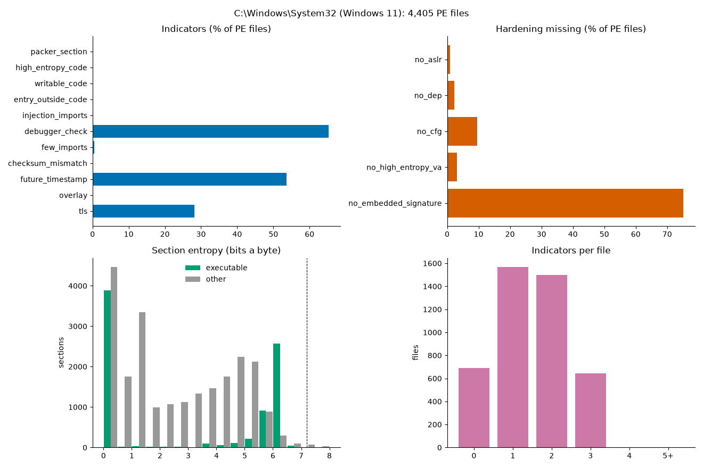

# pescan: static analysis of Windows PE files, every result computed twice

[](https://github.com/TexAlphaWolf/sec-static-analysis-pipeline/actions/workflows/ci.yml)
[](https://github.com/TexAlphaWolf/sec-static-analysis-pipeline/actions/workflows/codeql.yml)


The first look at a suspicious Windows program is static: what it imports, how its sections are laid out, whether its code
looks compressed, what strings it carries, how it was built. `pescan` reads Portable Executable files (`.exe`, `.dll`, `.sys`
and the rest) without running them and reports hashes, the import hash, sections and their entropy, imports and exports,
URLs and addresses in the strings, and **sixteen traits**: eleven indicators (a packer's section name, compressed code, a
writable code section, imports used for process injection...) and five hardening checks (ASLR, DEP, Control Flow Guard...).
**Every result is computed twice**: the PE parser is written from the format's specification and compared field by field
with [pefile](https://github.com/erocarrera/pefile), and every trait is written both in Python and as a
[YARA rule](src/pescan/rules/traits.yar). A generator of PE files with known traits, decoys and damaged copies checks both.
A command line with tests, a Docker image that scans a folder read-only without network, and reports generated from the
numbers.



## What the numbers say

A real folder: the 4,716 files directly in `C:\Windows\System32` of a Windows 11 computer, scanned in Docker with 12
processes, every file also read by pefile and matched by YARA ([`docs/real.json`](docs/real.json),
[`docs/real.md`](docs/real.md); the published copy has a generic source name and file names only for the rare traits).
Speeds of single steps are from [`docs/bench.json`](docs/bench.json) (Docker on Linux x86_64, 12 CPUs, Python 3.13.18, medians
of 3 runs).

1. **On 4,405 real programs, the two parsers agree on every field and the two rule sets on every trait.** pefile reads all
   4,405 PE files the same as pescan's parser (20 fields each: headers, sections and their entropy, imports, exports, import
   hash; the checksum on the 4,306 files up to 4 MiB), and the YARA rules give the same set of traits as the Python ones on
   4,405 of 4,405. 311 files are not programs (`.nls`, `.png`, `.msc`...), none is malformed, none unreadable.
2. **Most "suspicious" traits are normal in Windows itself.** 65.3% of the files import `IsDebuggerPresent` (2,875), 53.6%
   have a link time stamp later than the day of the scan (2,362) and 28.2% have a TLS directory (1,243); 646 system files have
   three indicators or more, none has five. A count of indicators does not tell a malicious file from an operating system.
3. **The time stamps are not times.** They are spread evenly from the 1970s (272) to the 2100s (212), with no decade above 441:
   Windows is built reproducibly, and the field holds a value derived from the build instead of a date. If it were uniform over
   all 32-bit values, 58.2% would fall after the scan; 53.6% do.
4. **The rare traits have plain reasons.** 6 of 8,021 executable sections have an entropy of 7.2 bits a byte or more:
   `ClipUp.exe`, `GenValObj.exe`, `SppExtComObj.Exe` and `sppsvc.exe` (licence and software protection components),
   `d3dcsx_42.dll` and `WMVDECOD.DLL`. The 4 files that import `VirtualAllocEx`, `WriteProcessMemory` and `CreateRemoteThread`
   together are `dbgeng.dll`, `Faultrep.dll`, `kernel32.dll` and `ttdinject.exe`: a debugger engine, error reporting and time
   travel debugging, which write into other processes by design. The 21 programs with fewer than 4 imports are boot, hypervisor
   and microcode files (`hvix64.exe`, `mcupdate_GenuineIntel.dll`...).
5. **Windows signs most files outside the file.** 75.1% (3,308) carry no Authenticode signature of their own: they are signed
   in the system's catalogs, which a static look at one file does not see. The header checksum is right on 4,404 files and zero
   on 1. Hardening is almost everywhere: 0.8% lack ASLR (37 files), 2.3% DEP (101) and 9.5% Control Flow Guard (419).
6. **The parser is fast; the reference is not.** On 1,000 generated files (28.2 MB) pescan parses 488.2 MB a second and pefile
   1.8 MB a second (57.8 ms against 15.46 s); the traits, strings and entropy are the slowest own step (25.4 MB a second) and the
   YARA rules run at 52.5 MB a second. A whole scan goes from 500 files a second with 1 process to 1,865 with 8. System32 (3.0 GB)
   took 103 s with 12 processes, the pefile comparison included.
7. **Against a known truth, both rule sets are exact, and damaged files break nothing.** On 1,000 generated files with 2,407
   traits set, the Python traits and the YARA rules are wrong 0 times, and the parser reads every file the same as pefile. On
   3,000 damaged copies the parser refuses 842 with its own error and fails in no other way; where both parsers read a
   damaged copy they agree on 2,085 of 2,153, and YARA and Python agree on 1,823 of 2,158 (mostly because YARA reads every
   section header the count declares, while pefile and pescan stop at an empty one; see [`docs/analysis.md`](docs/analysis.md)).

## Quick start

```bash
pip install -e ".[dev]"
pescan corpus demo --files 300 --seed 1 --damaged 1      # generated PE files with a truth.json, and damaged copies
pescan scan demo --reference --out report                # report.json, report.md, summary.png, files.jsonl
pescan show demo/sample00001.exe                         # every field of one file, as JSON
pescan verify                                            # the two ways of computing, compared
pescan rules > traits.yar                                # the YARA rules, to use with yara itself
```

The demo corpus ([`docs/report.json`](docs/report.json), [`docs/report.md`](docs/report.md)) gives, without the timings:

```text
demo: 300 generated files and 300 damaged copies (seed 1): 601 files, 526 PE (13.8 MB), 2 not PE, 73 malformed, 0 unreadable, 0 too big
359 64-bit, 227 DLLs, 53 .NET, 181 with an embedded signature
indicators: checksum_mismatch 148, few_imports 112, entry_outside_code 58, overlay 58, debugger_check 49
files with 3 or more indicators: 76
YARA agrees with the Python traits on 473 of 526 files
pefile: 517 of 526 files read identically, 0 refused by pefile
against the truth: 300 of 300 files exactly right (Python), 300 (YARA)
```

The 53 YARA disagreements and the 9 pefile differences are all on damaged copies; on the 300 intact files, both agree
everywhere and both match the truth.

### In Docker, on a real folder

The image runs as an unprivileged user, with a read-only root filesystem, no capabilities and no network; the folder to scan is
mounted read-only. From Windows PowerShell:

```powershell
docker build -t pescan .
.\tools\docker_e2e.ps1          # corpus, scan, read-only scan, render, verify, benchmark: "docker end-to-end: OK"
.\tools\run_real.ps1            # C:\Windows\System32 (or -Path ...), with pefile and YARA: results\system32
.\tools\run_full.ps1            # the benchmark: results\bench.json, bench.md, bench.png
```

`tools/docker_e2e.sh` does the same from bash. `tools/publish_real.py` turns a real report into a copy fit to publish.

## How it works

- **[`pe.py`](src/pescan/pe.py)** reads the DOS, COFF and optional headers, the section table, imports (by name and by
  ordinal) and exports from bytes in memory, checking every offset against the file size; where the format leaves room
  (which section an address falls in, how a raw pointer is rounded, when a broken section table ends) it follows the loader's
  rules as pefile implements them. [`reference.py`](src/pescan/reference.py) reads the same 20 fields with pefile.
- **[`features.py`](src/pescan/features.py)** computes MD5, SHA-1 and SHA-256, the import hash (Mandiant's definition, as pefile
  and VirusTotal compute it), Shannon entropy per section (NumPy, and a literal one-value-at-a-time version), the PE checksum,
  printable strings with URLs, IPv4 addresses and registry paths, and the traits;
  [`rules/traits.yar`](src/pescan/rules/traits.yar) has the same traits as YARA rules.
- **[`build.py`](src/pescan/build.py) and [`corpus.py`](src/pescan/corpus.py)** write PE files from a specification (sections,
  imports, exports, TLS, a .NET header, an Authenticode-shaped blob, overlay, checksum), so every trait of a generated file is
  known before it is parsed; decoys look close to a trait without having it, and damaged copies have truncated files, random
  header bytes, impossible section tables and directories.
- **[`scan.py`](src/pescan/scan.py), [`analysis.py`](src/pescan/analysis.py), [`report.py`](src/pescan/report.py)** walk folders
  (no symbolic links, a size limit, several processes), build one record per file and a summary that is a pure function of the
  records, and write Markdown and a figure that are pure functions of the summary.

More in [`docs/method.md`](docs/method.md) (definitions), [`docs/architecture.md`](docs/architecture.md),
[`docs/analysis.md`](docs/analysis.md) (the results) and [`docs/limitations.md`](docs/limitations.md).

## Limits

A trait is a fact about how a file is built, not a verdict: the real folder shows how common the "suspicious" ones are in
benign software, and nothing here was measured on malware (none is in the repository, and none is needed for the tests). The
import hash, entropy and strings are the classic static signals; there is no disassembly, no unpacking, no resource or
certificate parsing (a signature is seen as present, not checked), and the real folder is one computer's System32. On damaged
files YARA and pefile read the section table differently, so traits computed from sections can differ there. yara-python has
wheels up to Python 3.13; on 3.14 it is compiled from source, and the image uses 3.13. See
[`docs/limitations.md`](docs/limitations.md).

## License

MIT, see [LICENSE](LICENSE).
